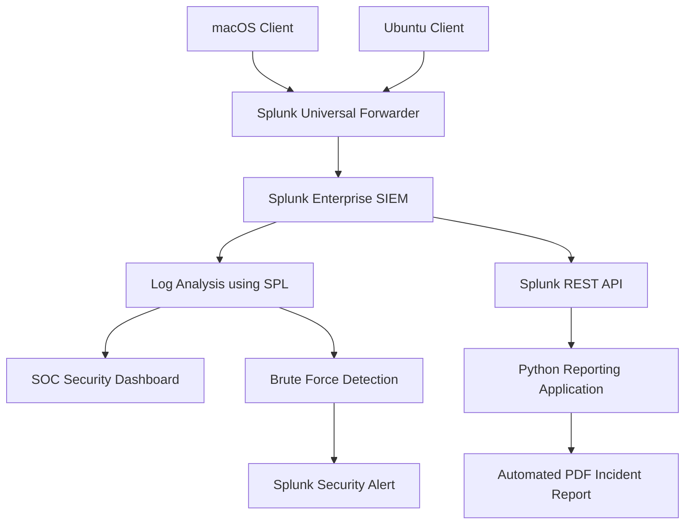

# SOC-SENTINEL
Automated Security Monitoring and Incident Reporting System
# 🛡️ SOC SENTINEL
### Automated Security Monitoring and Incident Reporting System

A practical Security Operations Center (SOC) lab built using Splunk Enterprise, Splunk Universal Forwarder, Ubuntu, macOS, and Python.

## 📌 Project Overview

SOC SENTINEL is a cybersecurity monitoring project designed to collect, monitor, analyse, and report security events.

The system monitors SSH authentication activities, identifies suspicious failed login patterns, generates security alerts, and produces automated PDF incident reports.

## 🎯 Objectives

- Centralised security log collection.
- SSH authentication monitoring.
- Failed and successful login analysis.
- Brute-force activity detection.
- SIEM dashboard development.
- Automated security alert configuration.
- Incident investigation.
- Python-based PDF reporting.

## 🏗️ System Architecture



## 🧰 Technologies Used

| Technology | Purpose |
|---|---|
| Splunk Enterprise 10.6.1.1 | SIEM |
| Splunk Universal Forwarder | Log forwarding |
| Ubuntu Linux | Server and client |
| macOS | Client log source |
| Python 3.13.7 | Automation |
| ReportLab | PDF generation |
| Requests | REST API integration |
| SPL | Security event analysis |
| UTM | Virtualisation |

## 🔍 Main Features

### 1. Security Log Monitoring
- macOS system logs
- Ubuntu authentication logs
- SSH authentication events

### 2. SSH Login Analysis
- Failed login monitoring
- Successful login monitoring
- Username extraction
- Source IP analysis

### 3. Brute-Force Detection
- Detection using Splunk SPL queries
- Scheduled alert execution
- Alert trigger history

### 4. SOC Dashboard
- Total security events
- Failed login attempts
- Successful SSH logins
- Login activity timeline
- Host-wise security events
- Incident investigation panels

### 5. Automated PDF Reporting
- Splunk REST API integration
- Security event retrieval
- Failed and successful login analysis
- Custom incident severity classification
- PDF incident report generation

## 📊 Sample Test Results

| Metric | Result |
|---|---:|
| Total SSH Events | 10 |
| Failed Logins | 9 |
| Successful Logins | 1 |

Note: These are controlled laboratory test results. The observed localhost events do not represent a confirmed external cyberattack.

## 📁 Project Structure

```text
SOC-SENTINEL/
│
├── SOC-Automated-Reporting/
│   ├── splunk_api_test.py
│   ├── generate_report.py
│   └── reports/
│
├── screenshots/
│
├── architecture/
│
└── README.md
```

## 🚀 Future Enhancements

- Automatic PDF generation when a Splunk alert triggers.
- Email-based security notifications.
- Daily and weekly SOC reports.
- Additional Linux security monitoring.
- Advanced threat detection.
- SOAR integration.

## 🎓 Learning Outcomes

This project provided practical experience in:

- SIEM operations
- Security log analysis
- SOC monitoring
- SSH authentication investigation
- Brute-force detection
- Alert configuration
- Python automation
- REST API integration
- Incident reporting

## 👨‍💻 Project Category

Cybersecurity | Blue Team | Security Operations Center | SIEM | Incident Response

**Project Name:** SOC SENTINEL  
**Status:** Core implementation completed
